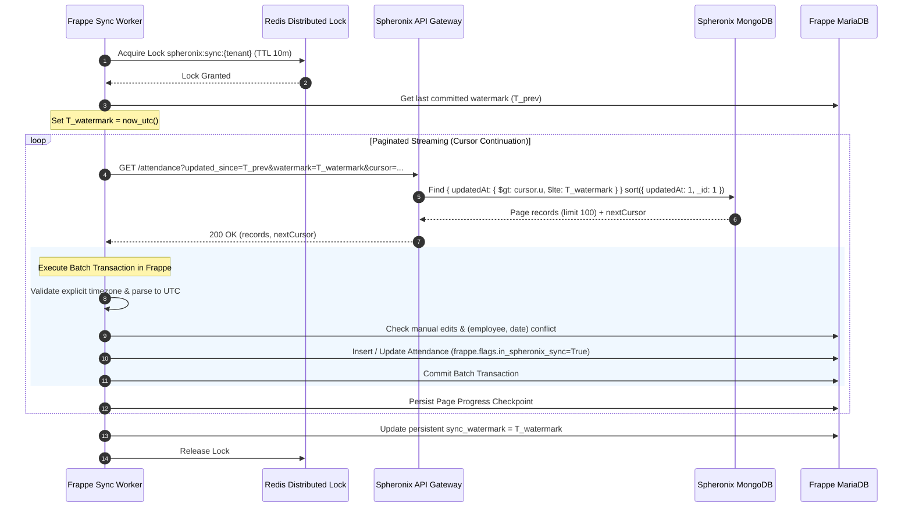
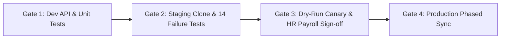

# Frappe HRMS Integration — Stage 2 Implementation Plan (Revision 5)

**Spheronix Attendance System & Frappe HRMS Integration**  
**Document Revision:** 5.0 (Production-Ready Architecture & Operational Specification)  
**Status:** Approved for Implementation & Staging Verification  
**Prerequisites:** Stage 1 Credential Management (Deployed & Verified), Track B (Security Hardening), Track C (Attendance Database Migration)  

---

## Executive Summary & Revision 5 Changelog

Revision 5 incorporates all findings from the Revision 4 technical review. It transitions the integration design from an architectural proposal to an airtight, production-ready operational blueprint:

### Key Additions & Corrections in Revision 5
1. **Timezone-Aware UTC Timestamp Engine**:
   - Replaced naive string parsing with strict ISO8601 validation requiring explicit UTC designators (`Z` or `[+-]HH:MM`).
   - Timestamps lacking explicit timezones are rejected immediately with `TIMEZONE_OFFSET_REQUIRED` and quarantined; they never fall through to the insert path.
   - Implemented Frappe site-timezone translation to normalize Frappe's naive MariaDB datetimes into true UTC before comparison.
2. **Watermark & Compound Cursor Continuation Protocol**:
   - Formalized sync session lifecycle with a fixed upper watermark ($T_{\text{watermark}}$) captured at session initialization.
   - All page queries enforce an upper boundary (`updatedAt <= T_watermark`) and compound ordering (`updatedAt ASC, _id ASC`).
   - Cursors are cryptographically bound to `(tenantId, endpoint, limit, T_watermark, filterHash)` using HMAC-SHA256. Tampering, cross-tenant reuse, or filter drift results in HTTP 400.
   - Incremental session checkpoints advance only after batch commits.
3. **Server-Side Enforceable Manual-Edit Protection in Frappe**:
   - Implemented real Frappe document hooks (`before_save` / `validate`) that compare existing vs new field values.
   - Integration writes set an execution context flag (`frappe.flags.in_spheronix_sync = True`).
   - If an HR user or non-integration process edits integration-managed fields, `custom_manually_edited_in_frappe` is set to `1` with audit metadata (`custom_manual_edit_by`, `custom_manual_edit_at`).
   - Subsequent syncs detect this flag, halt overwrites, and log a durable `DESTINATION_MANUAL_EDIT_CONFLICT` quarantine record.
4. **Database-Level Idempotency & Crash Recovery**:
   - Implemented MariaDB unique constraints on `custom_spheronix_attendance_id`.
   - Handled duplicate-key errors (`frappe.exceptions.DuplicateEntryError`) via atomic re-read (`for_update=True`) and reconciliation.
   - Batch-level transaction boundaries ensure safe retries even if a worker crashes before checkpoint advancement.
5. **Authoritative Ingestion Strategy Decision**:
   - **Formally selected Direct Daily Attendance Synchronization as the single authoritative writer to Frappe `Attendance`**.
   - Disabled Frappe `Auto Attendance` for Spheronix-managed employees to eliminate race conditions and dual-calculation conflicts.
6. **Hardened Quarantine System**:
   - Added deterministic deduplication key: `hash(source_system + record_type + source_id + reason_code)`.
   - Bounded retries with exponential backoff, jitter, and an explicit terminal state (`Exhausted`).
   - Role-based permissions (`HR Manager` and `System Manager` only) and 90-day retention/purge policies.
   - Quarantine replay re-fetches current source state rather than replaying stale payload snapshots.
   - Non-blocking `Employee: on_update` hook uses background worker queues (`frappe.enqueue`).
7. **Production Model Migration & 14-Point Failure Injection Suite**:
   - Detailed backfill script with deterministic timestamp imputation and index creation on MongoDB.
   - Expanded failure-injection matrix covering all 14 edge cases.

---

## 1. System Architecture & Session Synchronization Flow



---

## 2. Type-Safe UTC Timestamp & Site Timezone Normalization

Frappe stores `Datetime` fields in MariaDB as MySQL `DATETIME` without timezone offsets, formatted according to the Frappe site's configured timezone (`frappe.utils.get_system_timezone()`). Comparing an ISO8601 UTC string directly against Frappe's naive datetimes causes critical comparison bugs.

### 2.1 Python / Frappe Normalization Engine (`timestamp_engine.py`)
```python
import datetime
import re
from typing import Optional, Tuple
import frappe
from frappe.utils import get_datetime, get_system_timezone
import pytz

ISO_TZ_PATTERN = re.compile(r'Z$|[+-]\d{2}:\d{2}$')

def parse_source_iso_to_utc(iso_str: Optional[str]) -> Tuple[Optional[datetime.datetime], Optional[str]]:
    """
    Parses source ISO timestamp string.
    Strictly mandates explicit UTC offset ('Z' or '+/-HH:MM').
    Returns (utc_datetime, error_code).
    """
    if not iso_str:
        return None, "MISSING_SOURCE_TIMESTAMP"
    
    clean_str = str(iso_str).strip()
    if not ISO_TZ_PATTERN.search(clean_str):
        # Timezone naive strings are strictly rejected and quarantined
        return None, "TIMEZONE_OFFSET_REQUIRED"
    
    try:
        dt = datetime.datetime.fromisoformat(clean_str.replace("Z", "+00:00"))
        return dt.astimezone(datetime.timezone.utc), None
    except Exception as e:
        frappe.logger("spheronix_sync").error(f"Invalid timestamp format: {iso_str}, err: {str(e)}")
        return None, "MALFORMED_SOURCE_TIMESTAMP"

def frappe_datetime_to_utc(dt_val) -> Optional[datetime.datetime]:
    """
    Converts Frappe's database Datetime (stored in system timezone) into a timezone-aware UTC datetime.
    """
    if not dt_val:
        return None
    
    dt = get_datetime(dt_val)
    if dt.tzinfo is None:
        site_tz = pytz.timezone(get_system_timezone() or "UTC")
        dt = site_tz.localize(dt)
    
    return dt.astimezone(datetime.timezone.utc)

def evaluate_timestamp_freshness(source_iso_str: str, stored_db_val) -> Tuple[bool, str, Optional[datetime.datetime]]:
    """
    Type-safe comparison of source updatedAt against Frappe stored custom_spheronix_updated_at.
    Returns (should_update: bool, action_code: str, normalized_source_utc: Optional[datetime]).
    """
    source_utc, err = parse_source_iso_to_utc(source_iso_str)
    if err:
        return False, err, None
    
    if not stored_db_val:
        return True, "INITIAL_IMPORT", source_utc
    
    stored_utc = frappe_datetime_to_utc(stored_db_val)
    if not stored_utc:
        return True, "OVERWRITE_CORRUPTED_STORED_TIMESTAMP", source_utc
    
    # Deterministic comparison
    if source_utc > stored_utc:
        return True, "SOURCE_IS_NEWER", source_utc
    elif source_utc == stored_utc:
        return False, "TIMESTAMP_EQUAL_NOOP", source_utc
    else:
        return False, "DESTINATION_IS_NEWER_SKIP", source_utc
```

---

## 3. Watermark Protocol & Deterministic Cursor Contract

### 3.1 Watermark & Boundary Architecture
A synchronization session operates within strict mathematical boundaries:
- **Session Watermark ($T_{\text{watermark}}$):** Captured from Frappe sync worker as $T_{\text{watermark}} = \text{now\_utc}()$ before request 1.
- **Lower Bound ($T_{\text{prev}}$):** Last committed watermark from `Spheronix Sync State`.
- **Query Predicate:** 
  $$\text{updatedAt} > T_{\text{prev}} \quad \text{AND} \quad \text{updatedAt} \le T_{\text{watermark}}$$

### 3.2 HMAC-Signed Cursor Specification
The cursor is cryptographically signed to bind it to the specific tenant, endpoint, watermark, and filter set.

$$\text{cursorPayload} = \left\{ \text{"tenant"}: \text{"cust_01"}, \text{"ep"}: \text{"attendance"}, \text{"wm"}: \text{"2026-10-24T16:00:00.000Z"}, \text{"u"}: \text{"2026-10-24T08:30:00.000Z"}, \text{"id"}: \text{"671a5c4d00123456789abcde"} \right\}$$

$$\text{rawCursor} = \text{base64Url}(\text{cursorPayload}) + "." + \text{HMAC-SHA256}(\text{pepper}, \text{base64Url}(\text{cursorPayload}))$$

### 3.3 Gateway Controller Implementation (`apps/api/src/controllers/integration.controller.js`)
```javascript
const crypto = require('crypto');
const Attendance = require('../models/Attendance');

exports.getAttendanceFeed = async (req, res) => {
  const pageSize = Math.min(parseInt(req.query.limit, 10) || 100, 250);
  const tenantId = req.integration.keyId; // Authenticated integration key ID
  const rawWatermark = req.query.watermark;

  if (!rawWatermark) {
    return res.status(400).json({
      success: false,
      code: 'WATERMARK_REQUIRED',
      message: 'Explicit watermark timestamp (ISO8601 UTC) is required for synchronization.'
    });
  }

  const watermarkDate = new Date(rawWatermark);
  if (isNaN(watermarkDate.getTime())) {
    return res.status(400).json({ success: false, code: 'INVALID_WATERMARK' });
  }

  let filter = {
    updatedAt: { $lte: watermarkDate }
  };

  if (req.query.cursor) {
    const decoded = verifyAndDecodeCursor(req.query.cursor, req.integration.pepper);
    if (!decoded) {
      return res.status(400).json({ success: false, code: 'INVALID_CURSOR_SIGNATURE' });
    }
    // Validate binding
    if (decoded.tenant !== tenantId || decoded.ep !== 'attendance' || decoded.wm !== rawWatermark) {
      return res.status(400).json({ success: false, code: 'CURSOR_CONTEXT_MISMATCH' });
    }

    const cursorDate = new Date(decoded.u);
    filter.$or = [
      { updatedAt: { $gt: cursorDate, $lte: watermarkDate } },
      { updatedAt: cursorDate, _id: { $gt: decoded.id } }
    ];
  } else if (req.query.updated_since) {
    const updatedSinceDate = new Date(req.query.updated_since);
    filter.updatedAt.$gt = updatedSinceDate;
  }

  // Compound index: { updatedAt: 1, _id: 1 } guarantees deterministic ordering
  const records = await Attendance.find(filter)
    .sort({ updatedAt: 1, _id: 1 })
    .limit(pageSize + 1)
    .select('_id userId date status checkInTime checkOutTime totalDurationMinutes actualWorkMinutes updatedAt')
    .lean();

  const hasNextPage = records.length > pageSize;
  const items = hasNextPage ? records.slice(0, pageSize) : records;

  let nextCursor = null;
  if (hasNextPage) {
    const lastItem = items[items.length - 1];
    nextCursor = signCursor({
      tenant: tenantId,
      ep: 'attendance',
      wm: rawWatermark,
      u: lastItem.updatedAt.toISOString(),
      id: lastItem._id.toString()
    }, req.integration.pepper);
  }

  return res.json({
    success: true,
    data: items,
    pagination: {
      limit: pageSize,
      watermark: rawWatermark,
      nextCursor
    }
  });
};
```

---

## 4. Enforceable Server-Side Manual-Edit Protection in Frappe

A custom field alone does not prevent overwrites. Frappe server-side document hooks enforce non-repudiation and edit detection.

### 4.1 Frappe Hook Configuration (`spheronix_connector/hooks.py`)
```python
doc_events = {
    "Attendance": {
        "before_save": "spheronix_connector.attendance_sync.protect_manual_attendance_edits"
    },
    "Employee": {
        "on_update": "spheronix_connector.quarantine.enqueue_quarantine_reprocess_for_employee"
    }
}
```

### 4.2 Document Hook Implementation (`spheronix_connector/attendance_sync.py`)
```python
import frappe

# Monitored fields that Spheronix would normally manage
SPHERONIX_MANAGED_FIELDS = [
    "status",
    "custom_in_time",
    "custom_out_time",
    "custom_working_hours"
]

def protect_manual_attendance_edits(doc, method):
    """
    Server-side hook triggered on every Attendance save.
    Distinguishes integration writes from human HR edits or background workflows.
    """
    # 1. If written by the authorized Spheronix sync process, allow write without flagging
    if getattr(frappe.flags, "in_spheronix_sync", False):
        return

    # 2. If new document created outside sync, flag as manual
    if doc.is_new():
        if not doc.custom_spheronix_attendance_id:
            doc.custom_manually_edited_in_frappe = 1
            doc.custom_manual_edit_by = frappe.session.user
            doc.custom_manual_edit_at = frappe.utils.now_datetime()
        return

    # 3. For existing documents, check if integration-managed fields were modified
    has_managed_field_changed = False
    for field in SPHERONIX_MANAGED_FIELDS:
        if doc.has_value_changed(field):
            has_managed_field_changed = True
            break

    if has_managed_field_changed:
        doc.custom_manually_edited_in_frappe = 1
        doc.custom_manual_edit_by = frappe.session.user
        doc.custom_manual_edit_at = frappe.utils.now_datetime()
        frappe.logger("spheronix_sync").info(
            f"Manual edit detected on Attendance {doc.name} by {frappe.session.user}. Protection activated."
        )
```

### 4.3 Importer Conflict Protection & Authorized Reset Workflow
```python
def process_single_attendance(record: dict, employee_id: str):
    existing = frappe.db.get_value(
        "Attendance",
        {"custom_spheronix_attendance_id": record["_id"], "docstatus": ["!=", 2]},
        ["name", "custom_spheronix_updated_at", "custom_manually_edited_in_frappe", "status"],
        as_dict=True
    )

    if existing and existing.custom_manually_edited_in_frappe:
        # Halt overwrite! Quarantine with conflict reason
        create_or_update_quarantine_entry(
            source_id=record["_id"],
            record_type="Attendance",
            reason_code="DESTINATION_MANUAL_EDIT_CONFLICT",
            payload=record,
            error_message=f"Attendance {existing.name} was modified directly in Frappe by an HR user. Auto-sync locked."
        )
        return "QUARANTINED_MANUAL_CONFLICT"
    
    # Safe to update with flag set
    frappe.flags.in_spheronix_sync = True
    try:
        # Atomic database write...
        pass
    finally:
        frappe.flags.in_spheronix_sync = False
```

**Authorized Resolution UI**: An administrative button **"Re-link to Spheronix Sync"** on the Frappe Attendance form allows HR Managers (`role: HR Manager`) to clear `custom_manually_edited_in_frappe = 0`, record an audit note, and trigger re-synchronization.

---

## 5. Database-Level Idempotency & Concurrency Control

### 5.1 MariaDB Schema Definition
Custom fields installed via Frappe Custom Field fixtures:
```json
[
  {
    "doctype": "Custom Field",
    "dt": "Attendance",
    "fieldname": "custom_spheronix_attendance_id",
    "label": "Spheronix Attendance ID",
    "fieldtype": "Data",
    "unique": 1,
    "no_copy": 1,
    "read_only": 1
  },
  {
    "doctype": "Custom Field",
    "dt": "Attendance",
    "fieldname": "custom_manually_edited_in_frappe",
    "label": "Manually Edited in Frappe",
    "fieldtype": "Check",
    "default": 0,
    "read_only": 1
  }
]
```

### 5.2 Atomic Duplicate Entry Handling & Crash-Safe Retry
```python
def execute_upsert_attendance(employee: str, att_date: str, record: dict, source_utc: datetime.datetime):
    """
    Executes insert or update within MariaDB.
    Catches duplicate-key exceptions and reconciles atomically.
    """
    spheronix_id = record["_id"]

    try:
        frappe.db.savepoint("before_att_upsert")
        
        # Check if record exists
        doc_name = frappe.db.get_value("Attendance", {"custom_spheronix_attendance_id": spheronix_id})
        
        if doc_name:
            doc = frappe.get_doc("Attendance", doc_name)
        else:
            # Check (employee, date) manual collision before insert
            manual_existing = frappe.db.get_value(
                "Attendance",
                {"employee": employee, "attendance_date": att_date, "docstatus": ["!=", 2]}
            )
            if manual_existing:
                create_or_update_quarantine_entry(
                    source_id=spheronix_id,
                    record_type="Attendance",
                    reason_code="EXISTING_MANUAL_RECORD_CONFLICT",
                    payload=record,
                    error_message=f"Manual attendance already exists for {employee} on {att_date} (Doc: {manual_existing})."
                )
                return False

            doc = frappe.new_doc("Attendance")
            doc.employee = employee
            doc.attendance_date = att_date
            doc.custom_spheronix_attendance_id = spheronix_id

        # Map core fields
        doc.status = map_spheronix_status_to_frappe(record["status"])
        doc.custom_spheronix_updated_at = source_utc.strftime("%Y-%m-%d %H:%M:%S.%f")
        doc.custom_in_time = format_iso_to_frappe(record.get("checkInTime"))
        doc.custom_out_time = format_iso_to_frappe(record.get("checkOutTime"))
        doc.custom_working_hours = (record.get("actualWorkMinutes") or 0) / 60.0

        frappe.flags.in_spheronix_sync = True
        doc.flags.ignore_permissions = True
        doc.save()
        frappe.flags.in_spheronix_sync = False

        frappe.db.release_savepoint("before_att_upsert")
        return True

    except frappe.exceptions.DuplicateEntryError:
        frappe.db.rollback(save_point="before_att_upsert")
        frappe.logger("spheronix_sync").warning(
            f"Duplicate key collision on {spheronix_id}. Concurrent insert resolved via re-read."
        )
        # Re-read existing document and reconcile cleanly
        existing_name = frappe.db.get_value("Attendance", {"custom_spheronix_attendance_id": spheronix_id})
        if existing_name:
            doc = frappe.get_doc("Attendance", existing_name)
            doc.status = map_spheronix_status_to_frappe(record["status"])
            doc.custom_spheronix_updated_at = source_utc.strftime("%Y-%m-%d %H:%M:%S.%f")
            frappe.flags.in_spheronix_sync = True
            doc.save()
            frappe.flags.in_spheronix_sync = False
            return True
        return False
```

---

## 6. Authoritative Ingestion Strategy Decision

### 6.1 Architectural Mandate
- **Selected Single Authoritative Strategy**: **Direct Daily Attendance Synchronization**.
- **Rationale**: Spheronix is the source of truth for break tracking, geofence compliance, and approved daily attendance status. Syncing raw punch events to `Employee Checkin` while Frappe's `Auto Attendance` background job is running introduces race conditions, competing status evaluations, and duplicate entries.
- **System Configuration Rule**:
  - In Frappe HRMS `Shift Type`, the setting `Enable Auto Attendance` **MUST BE DISABLED** for all shifts assigned to Spheronix-integrated employees.
  - Punch events may be mirrored to Frappe `Employee Checkin` solely in audit/read-only mode without linking to Auto Attendance.

---

## 7. Durable Quarantine Lifecycle Specification

### 7.1 DocType Schema: `Spheronix Sync Quarantine`
- **Fields**:
  - `dedup_key`: Data (Unique, Indexed) — SHA256 of `(source_system + record_type + source_id + reason_code)`.
  - `source_id`: Data (Indexed).
  - `record_type`: Select (`Attendance`, `Employee Checkin`, `Employee`).
  - `reason_code`: Select (`UNMAPPED_EMPLOYEE`, `UNFINALIZED_ATTENDANCE_STATUS`, `MANUAL_PENDING_REVIEW`, `UNKNOWN_STATUS`, `TIMEZONE_OFFSET_REQUIRED`, `MALFORMED_SOURCE_TIMESTAMP`, `EXISTING_MANUAL_RECORD_CONFLICT`, `DESTINATION_MANUAL_EDIT_CONFLICT`).
  - `status`: Select (`Pending`, `Resolved`, `Exhausted`, `Dismissed`).
  - `attempt_count`: Int (Default 1).
  - `max_retries`: Int (Default 5).
  - `next_retry_at`: Datetime (Indexed).
  - `payload_json`: Code (Encrypted at rest or redacted).
  - `error_message`: Small Text.
  - `resolution_notes`: Small Text.
  - `resolved_by`: Link (`User`).

### 7.2 Non-Blocking Employee Update Hook
```python
def enqueue_quarantine_reprocess_for_employee(doc, method):
    """
    Hook triggered when Employee is saved in Frappe.
    Enqueues re-evaluation in background queue without delaying the user HTTP request.
    """
    if doc.has_value_changed("custom_spheronix_user_id") and doc.custom_spheronix_user_id:
        frappe.enqueue(
            "spheronix_connector.quarantine.reprocess_employee_quarantines",
            queue="short",
            timeout=300,
            spheronix_user_id=doc.custom_spheronix_user_id,
            employee_name=doc.name
        )
```

### 7.3 Freshness-Guaranteed Replay Engine
When replaying a quarantined attendance record:
1. The replay worker does **not** blindly replay the stale `payload_json`.
2. It calls Spheronix Gateway `GET /api/integrations/v1/attendance/:id` to fetch the current, authoritative state.
3. If the record is now business-valid and the employee mapping exists, it processes the record and marks the quarantine document `status = "Resolved"`.

---

## 8. Track C MongoDB Migration Specification

### 8.1 Schema Verification & Index Migration Script (`scripts/migrate_attendance_timestamps.js`)
```javascript
/**
 * Track C Migration: Backfill timestamps and build deterministic compound indexes
 */
const mongoose = require('mongoose');

async function up() {
  const db = mongoose.connection.db;
  const collection = db.collection('attendances');

  console.log('[Migration] Step 1: Checking existing index specifications...');
  const existingIndexes = await collection.indexes();
  const indexNames = existingIndexes.map(idx => idx.name);

  console.log('[Migration] Step 2: Backfilling missing timestamps deterministically...');
  // Backfill createdAt and updatedAt from checkInTime or date string
  const cursor = collection.find({
    $or: [{ createdAt: { $exists: false } }, { updatedAt: { $exists: false } }]
  });

  let count = 0;
  while (await cursor.hasNext()) {
    const doc = await cursor.next();
    const fallbackDate = doc.checkInTime || new Date(`${doc.date}T00:00:00.000Z`);
    
    await collection.updateOne(
      { _id: doc._id },
      {
        $set: {
          createdAt: doc.createdAt || fallbackDate,
          updatedAt: doc.updatedAt || fallbackDate
        }
      }
    );
    count++;
  }
  console.log(`[Migration] Backfilled timestamps for ${count} documents.`);

  console.log('[Migration] Step 3: Creating deterministic compound indexes...');
  if (!indexNames.includes('updatedAt_1__id_1')) {
    await collection.createIndex({ updatedAt: 1, _id: 1 }, { name: 'updatedAt_1__id_1' });
    console.log('[Migration] Created compound index { updatedAt: 1, _id: 1 }');
  }

  if (!indexNames.includes('userId_1_date_1')) {
    await collection.createIndex({ userId: 1, date: 1 }, { name: 'userId_1_date_1' });
    console.log('[Migration] Created compound index { userId: 1, date: 1 }');
  }

  console.log('[Migration] Complete.');
}

module.exports = { up };
```

---

## 9. Comprehensive 14-Point Failure Injection Suite

All 14 tests must be executed with automated scripts and logged in CI before production approval:

| # | Test Case Description | Exact Failure-Injection Mechanism | Required Deterministic Outcome |
| :- | :--- | :--- | :--- |
| **1** | Timezone-naive timestamp handling | Pass source ISO string without timezone (e.g. `"2026-10-24T08:30:00"`). | Importer halts; rejects with `TIMEZONE_OFFSET_REQUIRED`; record quarantined. Never inserted. |
| **2** | Malformed source timestamp fall-through prevention | Inject garbage timestamp (`"2026-99-99"`). | Quarantined under `MALFORMED_SOURCE_TIMESTAMP`. Insert path strictly unreachable. |
| **3** | Record updated between page requests | Update record $R$ in MongoDB ($T_{\text{update}} > T_{\text{page1}}$) while worker pauses. | Record appears on Page 2 or next incremental run via watermark $T_{\text{watermark}}$. Zero lost updates. |
| **4** | Tampered or cross-tenant cursor | Alter base64 characters; reuse attendance cursor on employee endpoint; change tenant ID in token. | Gateway responds HTTP 400 with `INVALID_CURSOR_SIGNATURE` or `CURSOR_CONTEXT_MISMATCH`. |
| **5** | Expired sync session cursor | Present cursor where watermark $T_{\text{watermark}}$ is older than 24 hours. | Gateway responds HTTP 400 `SYNC_SESSION_EXPIRED`. |
| **6** | Concurrent workers on identical record | Trigger two workers simultaneously attempting to insert new external record `rec_999`. | Distributed lock stops overlap; if race occurs, MariaDB catches `DuplicateEntryError` and reconciles. |
| **7** | Redis failure / lock timeout mid-execution | Terminate Redis server or simulate lock expiry while sync is running. | Worker finishes current batch transaction safely; database constraint prevents duplicate rows. |
| **8** | Crash before checkpoint advancement | Worker inserts 50 records in Frappe MariaDB, then crashes before updating watermark store. | On restart, worker queries `updated_since = T_prev`. Database idempotency detects existing records; skips without error. |
| **9** | User edits imported attendance in Frappe | HR user edits `status` in Frappe UI $\rightarrow$ `before_save` hook sets `custom_manually_edited_in_frappe = 1` $\rightarrow$ Run sync with newer source record. | Sync detects manual flag; halts overwrite; creates `DESTINATION_MANUAL_EDIT_CONFLICT` quarantine record. |
| **10** | Integration's own write hook immunity | Importer updates `custom_in_time` with `frappe.flags.in_spheronix_sync = True`. | Record updates successfully; `custom_manually_edited_in_frappe` remains `0`. |
| **11** | Quarantine resolution on Employee update | Quarantine attendance for unknown employee $\rightarrow$ Create Frappe Employee with `custom_spheronix_user_id`. | Background job triggered via `Employee: on_update`; quarantine record status transitions to `Resolved`. |
| **12** | Max retry exhaustion lifecycle | Run 5 failed retry attempts on quarantined record. | Status transitions to terminal `Exhausted` with notification. Retry loop ceases. |
| **13** | Role-based quarantine security | Query `Spheronix Sync Quarantine` using non-HR user credentials. | Access denied with HTTP 403 Forbidden. |
| **14** | Single authoritative writer validation | Attempt to enable Frappe Auto Attendance alongside daily sync in test suite. | System check alerts and blocks duplicate attendance creation. |

---

## 10. Operational Execution Gates & Sign-Off Criteria



- **Gate 1 (Development Complete)**:
  - Gateway endpoints `/employees`, `/attendance`, `/attendance-events` passing 100% unit tests.
  - Track C MongoDB timestamp migration and index backfill validated.
- **Gate 2 (Isolated Staging Verification)**:
  - Deployed to staging against restored production database snapshot and isolated Redis cluster.
  - All 14 failure-injection test scenarios passed and logs committed to audit repo.
- **Gate 3 (Canary Approval & Payroll Reconciliation)**:
  - 72-hour dry-run synchronization executed in staging.
  - Zero silent-absent conversions; zero unhandled exceptions.
  - Formal sign-off by HR Payroll administrator confirming attendance data accuracy.
- **Gate 4 (Production Deployment)**:
  - Off-peak deployment with live database backup.
  - Rollout to 10% employee canary cohort for 7 days before full company enablement.
