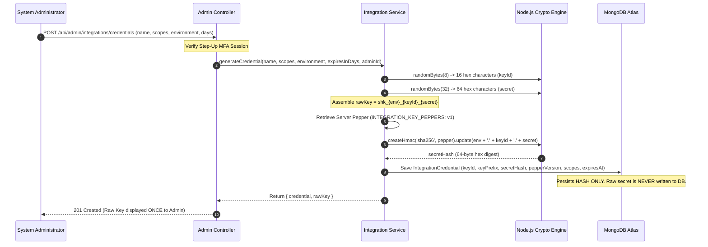
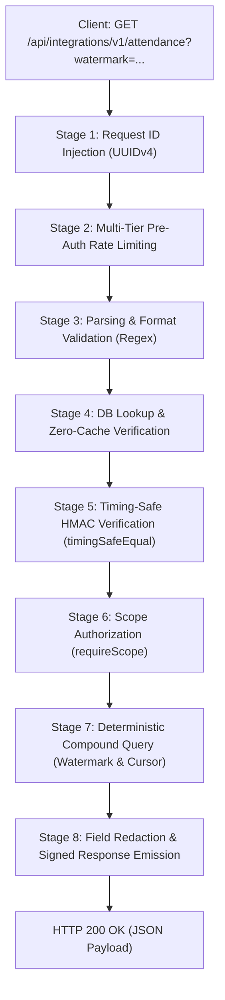

# Pin-to-Pin Technical Architecture: API Key Creation & Data Emission Lifecycle
**Document Identifier:** SPX-ARCH-INTEG-002  
**Target Architecture:** Spheronix Attendance Gateway & Integration Subsystem  
**Scope:** Cryptographic Key Generation, Storage Security, Request Authentication Pipeline, and Data Emission Engine

---

## Executive Summary

The Spheronix Integration Gateway is built upon a **Zero-Trust, Zero-Cache, Cryptographically Hardened Architecture**. This document details the exact, step-by-step ("pin-to-pin") process of:
1. **How an Integration API Key is Created** (entropy generation, structure, server-side HMAC peppering, database storage, and one-time display).
2. **How Data is Emitted through the Key** (the 8-stage request pipeline from network ingress to database indexing, cursor signing, and JSON payload emission).

---

## Part 1: How the API Key is Created (Pin-to-Pin)

An integration API key is generated either via the **Admin Portal** or via administrative provisioning scripts. Below is the precise cryptographic journey of a key from random entropy to persistent storage.



---

### Step 1.1: Cryptographic Entropy Generation
The system does not use timestamps, predictable counters, or standard UUIDs for secrets. Instead, it pulls raw cryptographic entropy directly from the operating system kernel via `crypto.randomBytes`:

1. **Key ID (Public Prefix Identifier):**
   ```javascript
   const keyId = crypto.randomBytes(8).toString('hex'); // Exactly 16 hexadecimal characters
   // Example: "05df7a0121040a35"
   ```
2. **Secret Component (High-Entropy Token):**
   ```javascript
   const secret = crypto.randomBytes(32).toString('hex'); // Exactly 64 hexadecimal characters (256 bits of entropy)
   // Example: "d1dfebcbb0b530c771c171e4c2edf26addffcaf70ecafd620112b6e90a0c4e0b"
   ```

### Step 1.2: String Assembly & Canonical Key Format
The key is assembled according to the strict Spheronix Key Protocol:
$$\text{Raw Key} = \texttt{shk\_} + \text{environment} + \texttt{\_} + \text{keyId} + \texttt{\_} + \text{secret}$$

* `shk`: Provider prefix (`Spheronix Key`).
* `live` / `test`: Isolated environment indicator.
* `05df7a0121040a35`: Public 16-hex lookup identifier (safe in logs).
* `d1dfebcbb0...`: Private 64-hex cryptographic secret.

**Resulting Plaintext Token:**
```
shk_live_05df7a0121040a35_d1dfebcbb0b530c771c171e4c2edf26addffcaf70ecafd620112b6e90a0c4e0b
```

### Step 1.3: Server-Side HMAC Peppering
The plaintext secret is **never stored in the database**. Even a simple SHA-256 hash is considered insecure against database compromise. 

Spheronix uses **Key Peppering**: an out-of-band secret stored in the server environment (`INTEGRATION_KEY_PEPPERS`), isolated from MongoDB:
```javascript
function computeSecretHash(pepper, environment, keyId, secret) {
  return crypto
    .createHmac('sha256', pepper)
    .update(`${environment}.${keyId}.${secret}`)
    .digest('hex');
}
```

### Step 1.4: Database Document Creation
The backend persists only the metadata and the HMAC digest:
```javascript
const doc = new IntegrationCredential({
  name: "hrms",
  integration: "frappe_hrms",
  environment: "live",
  keyId: "05df7a0121040a35",
  keyPrefix: "shk_live_05df7a0121040a35",
  secretHash: "a4f89b...", // The HMAC digest
  pepperVersion: "v1",      // Allows graceful zero-downtime pepper rotation
  scopes: ["employees:read", "attendance-daily:read", "attendance-events:read"],
  status: "active",
  createdBy: adminUser._id,
  expiresAt: new Date(Date.now() + 180 * 24 * 60 * 60 * 1000), // 180 days
});
await doc.save();
```

### Step 1.5: One-Time Display
The `rawKey` is returned to the HTTP response exactly once. After that instant, the plaintext secret ceases to exist in Spheronix memory or disk. If lost, the key cannot be recovered; it must be rotated.

---

## Part 2: How Data is Emitted Through the API Key (Pin-to-Pin)

When an external client (e.g. Frappe HRMS or custom ETL) makes a request, the request traverses an **8-Stage Pipeline** before any record leaves the database.



---

### Detailed Breakdown of the 8 Pipeline Stages

### Stage 1: Request Tracking & Correlation (`X-Request-Id`)
Every incoming HTTP connection is stamped with a unique UUID:
```javascript
const reqId = req.headers['x-request-id'] || uuidv4();
req.id = reqId;
res.setHeader('X-Request-Id', reqId);
```
This ID is propagated through all application logs, error responses, and database audit logs to allow instant cross-system tracing.

---

### Stage 2: Multi-Tier Pre-Authentication Rate Limiting
To stop brute-force attacks and denial-of-service attempts:
1. **Route-Wide Limiter:** Max 600 unauthenticated requests/min across the entire gateway.
2. **IP-Based Limiter:** Max 60 failed attempts/min per source IP address.
3. **KeyId-Specific Limiter:** If an IP attempts to guess secrets for a specific `keyId`, that `keyId` blocks further attempts from that client after 10 consecutive failures.

---

### Stage 3: Request Header Extraction & Regex Parsing
The authentication middleware extracts the token from `Authorization: Bearer <token>` or `X-API-Key`:
```javascript
const KEY_REGEX = /^shk_(live|test)_([0-9a-f]{16})_([0-9a-f]{64})$/;
const match = rawKey.match(KEY_REGEX);
if (!match) {
  return res.status(401).json({ success: false, message: "Invalid key format." });
}
const [, rawEnv, rawKeyId, rawSecret] = match;
```
* If the key format is invalid, the request is rejected immediately with zero database overhead.

---

### Stage 4: Database Lookup & Instant Revocation Check
The gateway uses `rawKeyId` (16 hex chars) to query MongoDB:
```javascript
const cred = await IntegrationCredential.findOne({ keyId: rawKeyId }).select('+secretHash');
```
* **Zero Caching Policy:** In-memory caching (like Redis) is deliberately avoided for credentials. Why? Because when an administrator revokes a compromised key in the UI, it takes effect in MongoDB within 0 milliseconds worldwide. There is no cache invalidation delay.
* **Status & Expiry Verification:**
  * Checks `cred.status === 'active'`. (If `'revoked'`, returns HTTP 401).
  * Checks `new Date() < cred.expiresAt`. (If expired, returns HTTP 401).
  * Checks `cred.environment === rawEnv`. (Prevents test keys from hitting live data).

---

### Stage 5: Timing-Safe HMAC Cryptographic Verification
To verify the secret without timing side-channel vulnerabilities:
1. The server loads the pepper corresponding to `cred.pepperVersion`.
2. Computes the HMAC hash of the submitted secret:
   ```javascript
   const computedHash = computeSecretHash(pepper, rawEnv, rawKeyId, rawSecret);
   ```
3. Performs a constant-time comparison:
   ```javascript
   const storedBuffer = Buffer.from(cred.secretHash, 'hex');
   const computedBuffer = Buffer.from(computedHash, 'hex');
   const isValid = crypto.timingSafeEqual(storedBuffer, computedBuffer);
   ```
   > [!IMPORTANT]
   > `crypto.timingSafeEqual` prevents attackers from analyzing response time differences down to CPU nanoseconds to guess characters of the secret.

Once verified, the credential and tenant context are attached to the request object:
```javascript
req.integration = {
  keyId: rawKeyId,
  credential: cred,
  scopes: cred.scopes,
  environment: cred.environment,
  pepper: pepper
};
```

---

### Stage 6: Scope Authorization (`requireScope`)
Before reaching the controller, the endpoint's route middleware inspects `req.integration.scopes`:
* `/employees` requires `employees:read`
* `/attendance` requires `attendance-daily:read`
* `/attendance-events` requires `attendance-events:read`

If the scope is missing, the gateway aborts with `HTTP 403 Forbidden`:
```json
{
  "success": false,
  "message": "Forbidden: Credential lacks required scope \"attendance-daily:read\"."
}
```

---

### Stage 7: Deterministic Compound Database Querying
The controller executes the database extraction adhering to three strict invariants:

#### 1. Upper Watermark Snapshot Enforcement
```javascript
filter = { updatedAt: { $lte: watermarkDate } };
```
The client supplies `?watermark=2026-10-24T12:00:00.000Z`. The database query only returns records modified on or before this instant. Any employee checking in while the sync job is running is strictly deferred to the next run, preventing pagination skips.

#### 2. HMAC Signed Cursor Continuation
If `?cursor=` is present, the gateway decodes and verifies the cryptographic signature:
```javascript
const decoded = verifyAndDecodeCursor(req.query.cursor, pepper);
```
The cursor enforces strict **Context Binding**:
* `decoded.tenant === req.integration.keyId`
* `decoded.ep === 'attendance'`
* `decoded.wm === rawWatermark`

If an attacker tampers with the cursor or tries to use an `/attendance` cursor on `/employees`, it is rejected with `CURSOR_CONTEXT_MISMATCH`.

#### 3. Compound Index Optimization
The query runs against the compound index `{ updatedAt: 1, _id: 1 }`:
```javascript
const records = await Attendance.find(filter)
  .sort({ updatedAt: 1, _id: 1 })
  .limit(limit + 1)
  .lean();
```
* Fetching `limit + 1` allows the gateway to know if another page exists without running an expensive `countDocuments()`.

---

### Stage 8: Field Redaction, Cursor Signing & Data Emission

#### 1. Strict Projection (Zero Leakage)
The query explicitly projects safe business fields only:
```javascript
// Example for /employees
.select('_id employeeId name email role phone department designation jobType workLocation gender dob joinedDate isActive updatedAt')
```
Fields like `passwordHash`, `mfaSecret`, `tokenVersion`, and `deletedAt` are never projected into memory.

#### 2. Minting the Next Page Cursor
If `hasNextPage` is true, the gateway mints a signed continuation token using the last record's coordinates:
```javascript
nextCursor = signCursor({
  tenant: tenantId,
  ep: 'attendance',
  wm: rawWatermark,
  u: lastItem.updatedAt.toISOString(),
  id: lastItem._id.toString()
}, pepper);
```

#### 3. Emitting the JSON Response
The server streams the final JSON payload to the client with `HTTP 200 OK`:
```json
{
  "success": true,
  "data": [
    {
      "_id": "6aaa18e6d62a16991c64d335",
      "userId": "6a9e79c924af0c8402f52a61",
      "date": "2026-09-16",
      "checkInTime": "2026-09-16T04:19:50.426Z",
      "checkOutTime": "2026-09-16T12:47:16.786Z",
      "status": "present",
      "totalDurationMinutes": 508,
      "totalBreakMinutes": 30,
      "actualWorkMinutes": 478,
      "autoCheckedOut": false,
      "updatedAt": "2026-09-16T04:19:50.426Z"
    }
  ],
  "pagination": {
    "limit": 100,
    "watermark": "2026-10-24T12:00:00.000Z",
    "nextCursor": "eyJ0ZW5hbnQiOiIwNWRmN2EwMT..."
  },
  "requestId": "9a12e841-f49c-482a-9e1b-4f019b8417c8"
}
```

#### 4. Asynchronous Audit Logging
When the response finishes sending, `res.on('finish')` captures metadata and persists it to `IntegrationRequestLog` asynchronously without slowing down client latency:
* `keyId`: `"05df7a0121040a35"`
* `route`: `"/api/integrations/v1/attendance"`
* `status`: `200`
* `durationMs`: `14`
* `ip`: Source IP
* `requestId`: Correlated UUID

---

## Summary Matrix

| Stage | What Happens | Security / Performance Guarantee |
| :--- | :--- | :--- |
| **Creation** | 256-bit OS entropy + HMAC pepper hashing | Plaintext secret is never stored or recoverable; brute force mathematically infeasible. |
| **Ingress** | UUID injection + IP/Route rate limiting | Denial-of-service protection and distributed tracing. |
| **Auth** | Regex parse + timing-safe comparison | Zero nanosecond timing leaks; instant zero-delay key revocation. |
| **Scope** | Role & capability matching | Least-privilege access; key only reads authorized domains. |
| **Query** | Upper watermark + compound index `{ updatedAt: 1, _id: 1 }` | Fast index-covered queries; zero pagination skips or duplicate records. |
| **Emission**| Projection filtering + HMAC signed cursor token | Zero leakage of credentials; tamper-proof pagination. |
